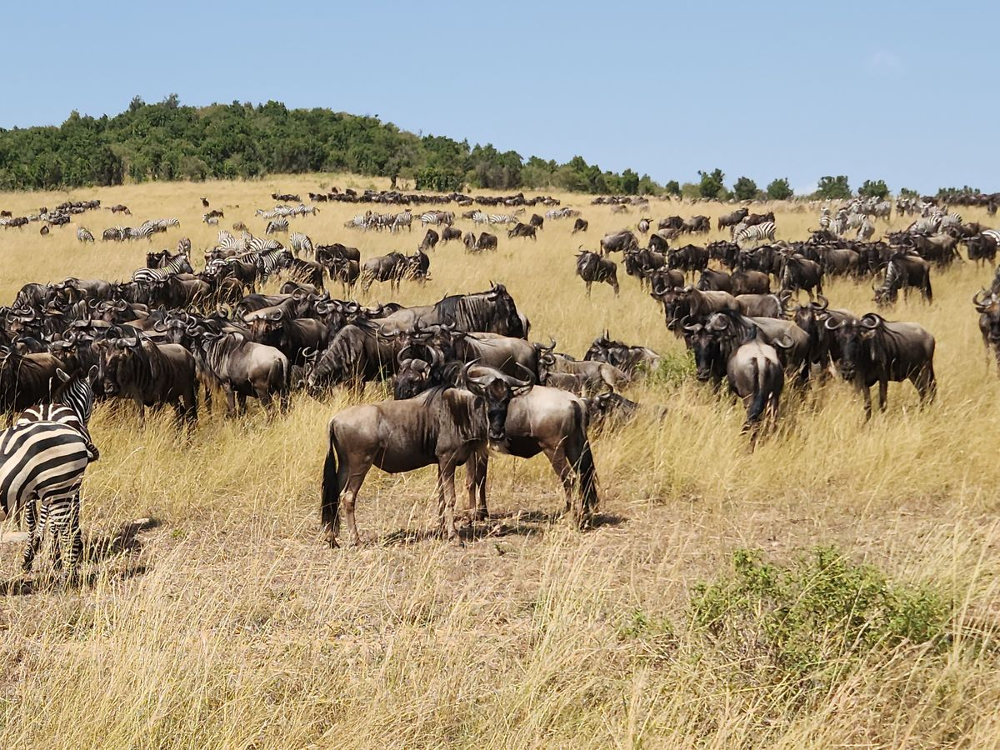
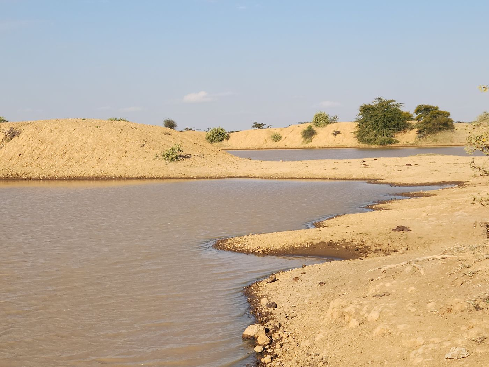
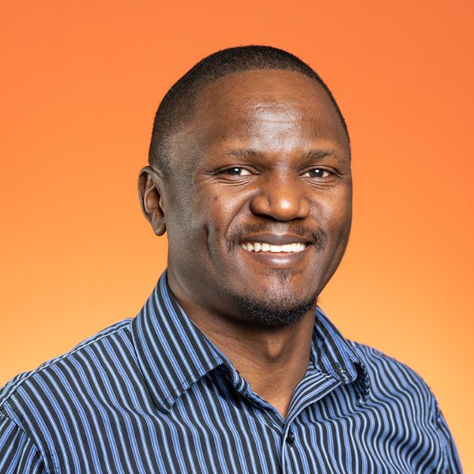
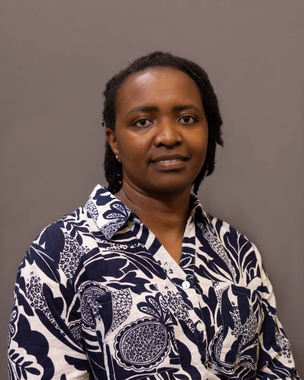
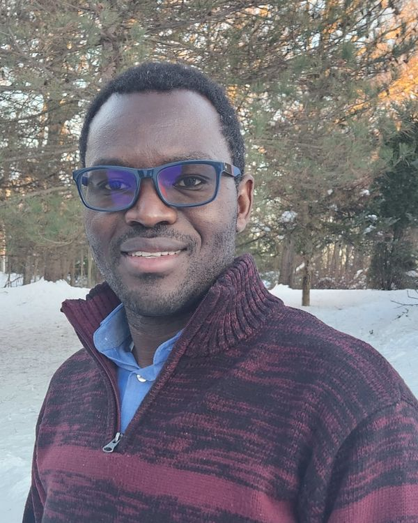

:::::::::::::::::::::::::::::::::::::::::::::::::::::::: eg-page
:::: {#hero .eg-hero .eg-hero-tint-dark .eg-hero-left .eg-hero-middle style="--eg-hero-img:url('images/web/hero-about.jpg');"}
::: eg-wrap
<!--[About us]{.eg-eyebrow}-->

# Our Mission: [Science for Changing Landscapes]{.colored-text}

## We deliver data-driven intelligence where it matters most.
:::
::::

::::::: {#history .eg-section .eg-history}
:::::: eg-wrap
::::: eg-history-grid
::: eg-history-photo
{fig-alt="Wildebeest and zebra grazing on open grassland"}
:::

::: eg-history-text
[Our story]{.eg-eyebrow}

## Three Researchers. One Shared Frustration.

ArdhiLytics began with conversations between long-time friends during our doctoral studies. Through years of research and fieldwork, we experienced firsthand the frustrations of fragmented data, limited access to information, and the effort required to turn data into meaningful insights.

Those experiences led us to a simple realization: good decisions require good information, but obtaining and using that information is often more difficult than it should be.

What started as an idea for improving data access evolved into a consulting practice that helps organizations navigate complex challenges through data-driven analysis, technology, and applied expertise.
:::
:::::
::::::
:::::::

::::::: {#positionality .eg-section .eg-position}
:::::: eg-wrap
::::: eg-position-grid
::: eg-position-text
[Positionality]{.eg-eyebrow}

## Beyond the map

Environmental challenges do not exist in isolation. Land-use decisions, ecosystems, climate, livelihoods, and governance are interconnected. That is why we combine remote sensing, spatial analysis, field data, and social-ecological understanding to provide a more complete picture of how landscapes function and change.

By integrating science with local knowledge and context, we help clients move beyond data collection and toward informed, practical, and lasting solutions.

```{=html}
<!--::: {.eg-about_map-box}
:::-->
```
:::

::: eg-position-photo
{fig-alt="Shallow river winding between sandy banks and scattered shrubs in a dryland landscape" loading="lazy" decoding="async"}
:::
:::::
::::::
:::::::

:::::::::::: {#how-we-work .eg-section .eg-timeline}
::::::::::: eg-wrap
:::::::::: eg-ses-card
::: eg-sec-head
[Our process]{.eg-eyebrow}

## How we work: the integrated lifecycle
:::

:::::::: eg-timeline-track
::: {.eg-timeline-step .eg-tl-1}
[01]{.eg-timeline-dot}

### Co-design

We bridge the gap between your specific objectives and the social-ecological reality of your landscape.
:::

::: {.eg-timeline-step .eg-tl-2}
[02]{.eg-timeline-dot}

### Data Synthesis

We synthesize diverse, multidimensional data streams, bridging remote sensing with complex social, environmental, and institutional inputs, to create a unified landscape perspective.
:::

::: {.eg-timeline-step .eg-tl-3}
[03]{.eg-timeline-dot}

### Modeling & Analysis

We use modern computational workflows to ensure your results are statistically sound, reproducible, and fully auditable.
:::

::: {.eg-timeline-step .eg-tl-4}
[04]{.eg-timeline-dot}

### Iterative Validation

We provide transparent, regular check-ins to ensure our modeling remains aligned with your expert on-the-ground knowledge.
:::

::: {.eg-timeline-step .eg-tl-5}
[05]{.eg-timeline-dot}

### Implementation Support

We deliver "Decision-Ready Intelligence" — providing you with transparent, verifiable, and actionable insights.
:::
::::::::
::::::::::
:::::::::::
::::::::::::

:::::::::::::::: {#core-values .eg-section .eg-values}
::::::::::::::: eg-wrap
::: eg-sec-head
[What drives us]{.eg-eyebrow}

## Core values
:::

::::::::::::: eg-cv-list
:::: {.eg-cv .eg-cv-1 tabindex="0"}
[<i class="bi bi-clipboard-data"></i>]{.eg-cv-icon}

### Scientific Integrity

::: eg-cv-desc
We prioritize evidence over convenience. Every model, map, and insight we deliver is held to the highest standards of accuracy, transparency, and reproducibility. We believe that robust data is the only reliable foundation for environmental action.
:::
::::

:::: {.eg-cv .eg-cv-2 tabindex="0"}
[<i class="bi bi-diagram-3"></i>]{.eg-cv-icon}

### Integrative Systems Thinking

::: eg-cv-desc
We see the landscape as a whole, not a collection of isolated parts. We actively bridge the gap between biophysical systems and social dynamics, recognizing that the most accurate solutions emerge at the intersection of disciplines.
:::
::::

:::: {.eg-cv .eg-cv-3 tabindex="0"}
[<i class="bi bi-eye"></i>]{.eg-cv-icon}

### Applied Transparency

::: eg-cv-desc
We operate in the open. Our workflows are documented, our methods are peer-review-ready, and our findings are auditable. We empower our partners by giving them full clarity into how we arrive at our conclusions, demystifying the "black box" of geospatial analysis.
:::
::::

:::: {.eg-cv .eg-cv-4 tabindex="0"}
[<i class="bi bi-geo-alt"></i>]{.eg-cv-icon}

### Field-Grounded Reality

::: eg-cv-desc
Data in a vacuum can be misleading. We bridge the distance between satellite-derived analytics and on-the-ground experience. We are committed to rigorous ground-truthing to ensure our work is theoretically sound, locally relevant, and actionable.
:::
::::

:::: {.eg-cv .eg-cv-5 tabindex="0"}
[<i class="bi bi-shield-check"></i>]{.eg-cv-icon}

### Resilient Stewardship

::: eg-cv-desc
We are driven by the long-term health of the landscapes we analyze. Our goal is to provide "Decision-Ready Intelligence" that protects ecosystems and supports community governance, ensuring our partners leave a lasting, positive footprint on the systems they manage.
:::
::::
:::::::::::::
:::::::::::::::
::::::::::::::::

::::::::::::::: {#team .eg-section .eg-founders}
:::::::::::::: eg-wrap
::: eg-sec-head
[Meet the team]{.eg-eyebrow}

## Our science team
:::

:::::::::::: eg-founder-grid
::::: eg-founder-card
::: eg-founder-photo
{fig-alt="Portrait of Donald Akanga"}
:::

### Donald Akanga

[Principal Scientist]{.eg-founder-role}

[Geospatial scientist and sustainability practitioner driving transformative impact by linking land‑change dynamics, resource management, and livelihood resilience.]{.eg-founder-expertise}

::: eg-founder-social
[<i class="bi bi-linkedin"></i>](https://www.linkedin.com/){target="_blank"} [Scholar](https://scholar.google.com/citations?user=oodpRpcAAAAJ&hl=en){target="_blank"}
:::
:::::

::::: eg-founder-card
::: eg-founder-photo
{fig-alt="Portrait of Susan Kotikot"}
:::

### Susan Kotikot

[Principal Scientist]{.eg-founder-role}

[Geospatial Data Scientist and Landscape Ecologist specializing in arid and semi-arid landscape (ASAL) management, land-use modeling, and regenerative landscape science.]{.eg-founder-expertise}

::: eg-founder-social
[<i class="bi bi-linkedin"></i>](https://www.linkedin.com/in/susankotikot/){target="_blank"} [Scholar](https://scholar.google.com/citations?user=GiHpEEsAAAAJ&hl=en&oi=ao){target="_blank"}
:::
:::::

::::: eg-founder-card
::: eg-founder-photo
{fig-alt="Portrait of Dan Wanyama"}
:::

### Dan Wanyama

[Principal Scientist]{.eg-founder-role}

[Geospatial Scientist and Environmental Geographer specializing in forest and agricultural land-use change dynamics, climate variability and human-environment interactions, and socio-ecological vulnerability.]{.eg-founder-expertise}

::: eg-founder-social
[<i class="bi bi-linkedin"></i>](https://www.linkedin.com/){target="_blank"} [Scholar](https://scholar.google.com/citations?user=FGzG0GEAAAAJ&hl=en){target="_blank"}
:::
:::::
::::::::::::
::::::::::::::
:::::::::::::::

:::::: {#contact .eg-section .eg-contact}
::::: eg-contact-wrap
::: eg-contact-left
## Have a landscape that needs a closer look?

Tell us what you're trying to prove, protect, or plan for. Let us discuss which layers apply.
:::

::: eg-contact-box
[EMAIL]{.eg-mono-label}

[info\@ardhilytics.com](mailto:info@ardhilytics.com){.eg-email}

[BASED IN]{.eg-mono-label}

[Nairobi, Kenya]{.eg-email-sub}

[Send us a brief](mailto:info@ardhilytics.com){.eg-btn .eg-btn-solid}
:::
:::::
::::::
::::::::::::::::::::::::::::::::::::::::::::::::::::::::
