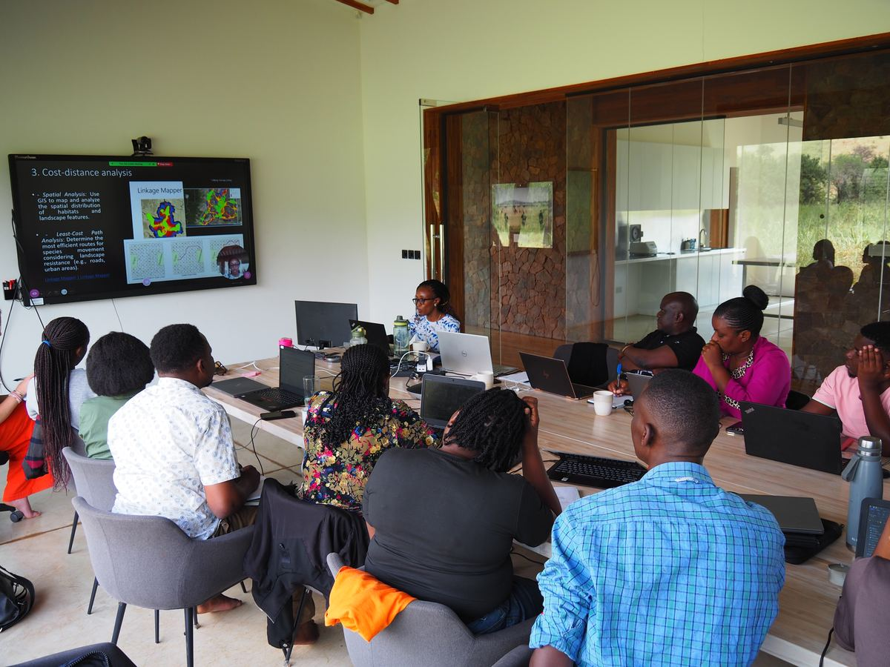
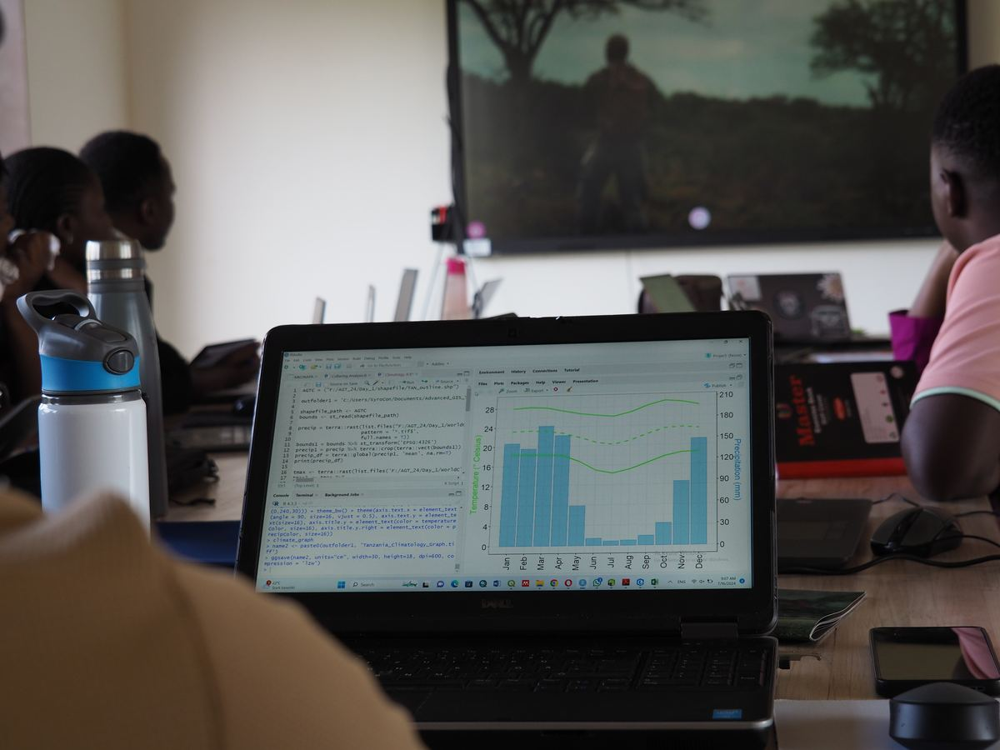
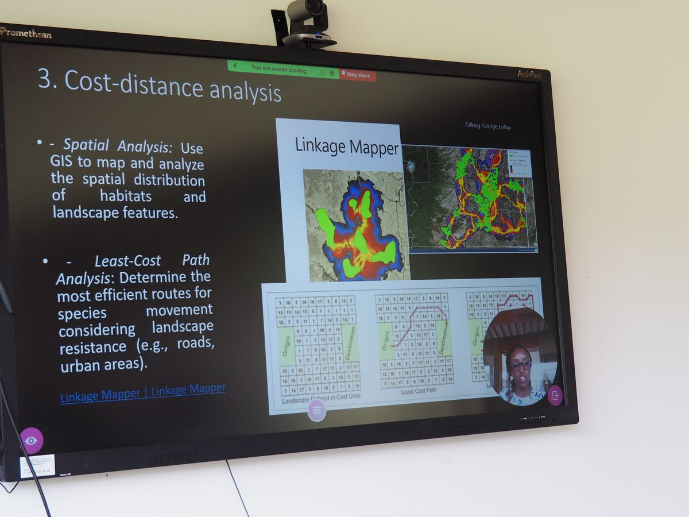

::::::::::::::::::: eg-page

:::: {#hero .eg-hero .eg-hero-tint-dark .eg-hero-tint-on .eg-hero-left .eg-hero-middle style="--eg-hero-img:url('images/web/hero-agt-cohort.jpg');"}
::: eg-wrap
[Case study — Technical consulting & capacity building]{.eg-eyebrow}

# Advanced GIS Training for Conservation Practitioners

[An annual, hands-on training in geospatial analysis for early to mid-career conservation practitioners, held in the Serengeti ecosystem, Tanzania.]{.eg-lede}

::: eg-hero-ctas
[Talk to us about training](contact.qmd){.eg-btn .eg-btn-solid} [Back to services](services.qmd#consulting){.eg-btn .eg-btn-outline}
:::
:::
::::

:::::: {#overview .eg-section}
::::: eg-wrap

::: eg-sec-head
[Programme overview]{.eg-eyebrow}

## Building geospatial skills where conservation happens
:::

::: eg-cs-text
The Advanced GIS Training (AGT) is hosted by Research and Innovation for the Serengeti Ecosystem (RISE) at the Grumeti Fund, and organized with collaborators from Pennsylvania State University, Montana State University Billings, the University of Connecticut and the University of Dar es Salaam. Three of its five instructors are ArdhiLytics' principal scientists.

The training is designed for professionals, researchers and graduate students who already have a basic background in GIS and want to deepen their skills in analyzing climate and environmental data. It centres on advanced geospatial methods applied to freely available data, so that participants can keep using what they learn in their own institutions.
:::

::: eg-cs-facts
::: eg-cs-fact
[2024 & 2025]{.eg-cs-fact-val}

[Two annual editions, each in July]{.eg-cs-fact-lbl}
:::

::: eg-cs-fact
[12 countries]{.eg-cs-fact-val}

[Represented in the 2024 cohort]{.eg-cs-fact-lbl}
:::

::: eg-cs-fact
[On site + online]{.eg-cs-fact-val}

[Hybrid format: in person at Grumeti, with online places]{.eg-cs-fact-lbl}
:::
:::

:::::
::::::

:::::: {#curriculum .eg-section .eg-services}
::::: eg-wrap

::: eg-sec-head
[Curriculum]{.eg-eyebrow}

## Six modules, from data access to habitat connectivity
:::

::::: eg-values-grid

::: eg-value-item
### GIS fundamentals for ecologists
Core concepts and workflows in ArcGIS Pro.
:::

::: eg-value-item
### Spatial data sources and access
Finding, downloading and processing open climate and environmental data with Google Earth Engine and R.
:::

::: eg-value-item
### Habitat suitability and connectivity
GIS and multi-criteria analysis for habitat suitability, and cost-distance and least-cost path methods for species movement.
:::

::: eg-value-item
### Vegetation analysis
Time series of vegetation and landscape change in R and Google Earth Engine.
:::

::: eg-value-item
### Landscape pattern analysis
Quantifying landscape structure and pattern with spatial statistics in R.
:::

::: eg-value-item
### Spatial analysis of ecological data
Analyzing ecological data in R, and presenting results as maps and figures.
:::

:::::

:::::
::::::

:::::: {#format .eg-section}
::::: eg-wrap

::: eg-sec-head
[How it runs]{.eg-eyebrow}

## A typical training day

Each day combines self-paced study with group work and live teaching. Two instructors teach on site and three join remotely, and participants are expected to take charge of their own learning.
:::

::: eg-cs-findings
::: {.eg-cs-finding .eg-cs-water}
[Morning]{.eg-cs-tag}

### Self-learning

Participants wrap up the previous day's exercise and work through self-learning material, starting on the first day with orientation and software set-up.
:::

::: {.eg-cs-finding .eg-cs-season}
[Midday]{.eg-cs-tag}

### Instructor-led lecture

A live session introduces the day's method, for example multi-criteria habitat suitability mapping or landscape pattern analysis in R.
:::

::: {.eg-cs-finding .eg-cs-food}
[Afternoon]{.eg-cs-tag}

### Hands-on practice

Guided hands-on activities apply the method to freely available climate and environmental data.
:::

::: {.eg-cs-finding .eg-cs-energy}
[Late afternoon]{.eg-cs-tag}

### Individual and group exercises

Participants complete exercises on their own or in teams, producing maps and figures from their analysis.
:::
:::

:::::
::::::

:::::: {#cohort .eg-section .eg-services}
::::: eg-wrap

::: eg-sec-head
[Who took part]{.eg-eyebrow}

## A diverse, international cohort

The 2024 cohort brought together conservation practitioners, researchers and students from across Africa and beyond, with backgrounds ranging from wildlife management and ecology to geomatics.
:::

::: eg-cs-chips
[Tanzania]{.eg-chip} [Kenya]{.eg-chip} [Rwanda]{.eg-chip} [Zambia]{.eg-chip} [Zimbabwe]{.eg-chip} [Botswana]{.eg-chip} [Nigeria]{.eg-chip} [DR Congo]{.eg-chip} [South Africa]{.eg-chip} [India]{.eg-chip} [United Kingdom]{.eg-chip} [United States]{.eg-chip}
:::

:::::
::::::

:::::: {#field-visit .eg-section .eg-field}
::::: eg-wrap

::: eg-sec-head
[In the room]{.eg-eyebrow}

## Scenes from the training

Photos: Daniel Samwel
:::

:::: {.eg-field-grid .eg-field-grid-3}
:::: eg-field-photo
::: eg-field-img
{fig-alt="Participants at laptops around a table in the RISE training room, with a lecture on screen" loading="lazy" decoding="async"}
:::

[Participants at the RISE facility follow a live session on habitat connectivity.]{.eg-field-cap}
::::

:::: eg-field-photo
::: eg-field-img
{fig-alt="A laptop showing R code and a climate chart during a hands-on session" loading="lazy" decoding="async"}
:::

[Hands-on analysis of climate data in R.]{.eg-field-cap}
::::

:::: eg-field-photo
::: eg-field-img
{fig-alt="Screen showing a lecture slide on cost-distance analysis with a remote instructor" loading="lazy" decoding="async"}
:::

[A remote instructor teaches cost-distance and least-cost path analysis.]{.eg-field-cap}
::::
::::

:::::
::::::

:::::: {#contact .eg-section .eg-contact}
::::: eg-contact-wrap

::: eg-contact-left
## Want to build your team's geospatial skills?

Tell us who you're training and what they need to do, and let us design a programme around it.
:::

::: eg-contact-box
[EMAIL]{.eg-mono-label}

[info\@ardhilytics.com](mailto:info@ardhilytics.com){.eg-email}

[Send us a brief](contact.qmd){.eg-btn .eg-btn-solid}
:::

:::::
::::::

:::::::::::::::::::
