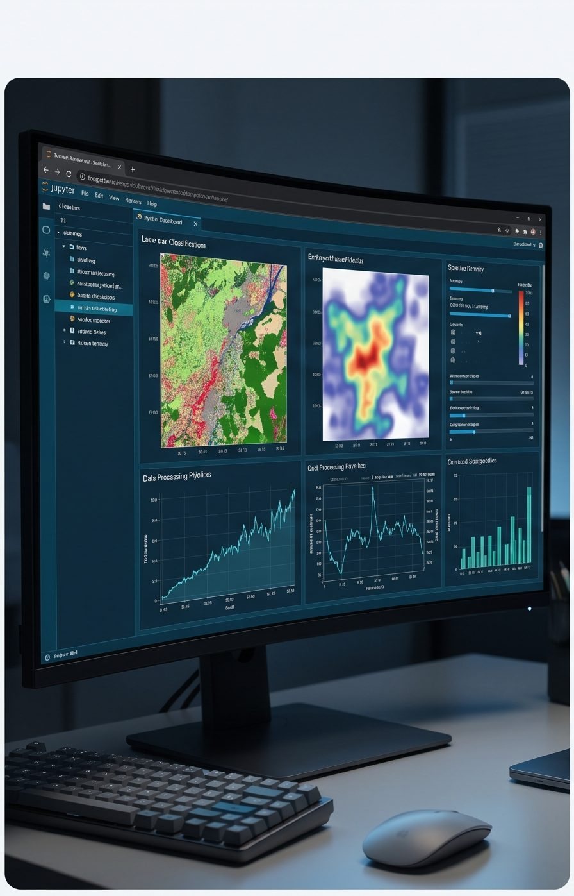
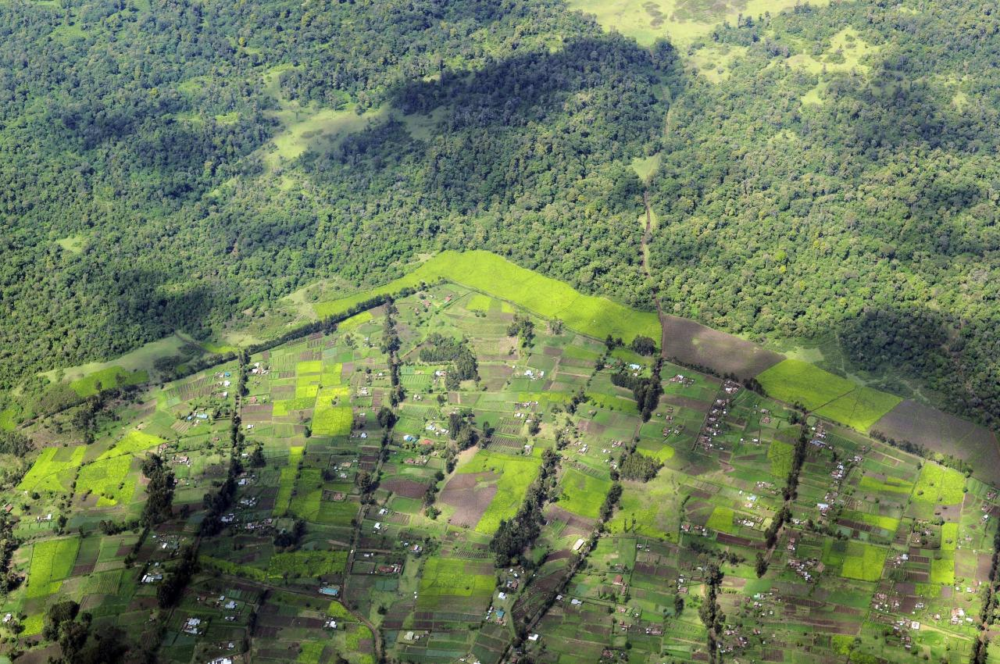
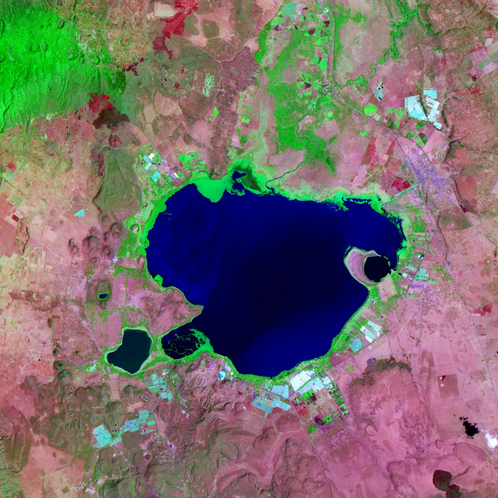
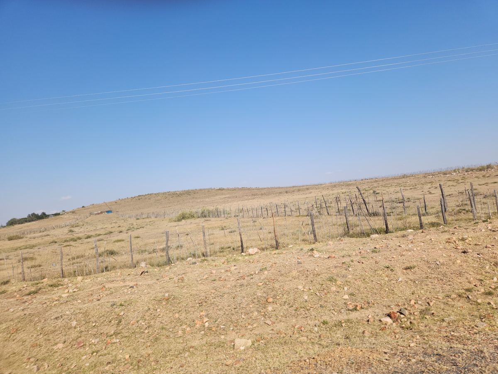
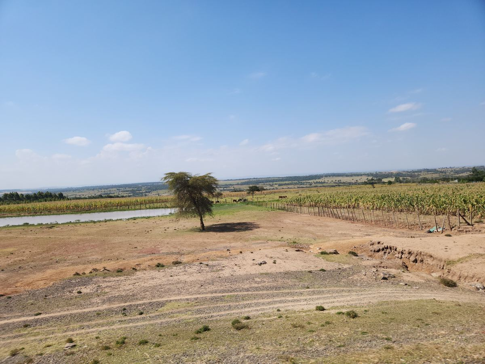

::: {.eg-page}

::: {.eg-hero .eg-hero-tint-dark .eg-hero-tint-on .eg-hero-left .eg-hero-middle .eg-hero-large style="--eg-hero-img:url('images/web/hero-services.jpg');"}
::: {.eg-wrap}

## From Data to Decisions: [Landscape Intelligence You Can Use]{.colored-text}

::: {.eg-lede}
We help governments, conservation organizations, development partners and land managers across East Africa understand their landscapes and plan for what comes next. From reliable data and hands-on training to mapping, modeling and conservation planning, we turn complex spatial and environmental information into clear, practical insight.
:::

::: {.eg-hero-ctas}
[Start a project](contact.qmd){.eg-btn .eg-btn-solid}
:::

:::
:::

::: {#services .eg-section .eg-services}
::: {.eg-wrap}
::: {.eg-sec-head}
[Services]{.eg-eyebrow}

## Six layers of analysis, stacked around one landscape.

Whether you need a specific analysis or an end-to-end assessment, our services scale to match your needs.

:::

::: {.eg-layer-stack .eg-dark-panel}

::: {#data .eg-layer .eg-l1}
::: {.eg-layer-marker}
[ ]{.eg-layer-toggle .eg-l1}

[LAYER 01]{.eg-layer-index}
:::

::: {.eg-layer-body}
::: {.eg-layer-main}
### Data Services & Decision Support

[Reliable data, ready for analysis and decisions.]{.eg-layer-one-liner .eg-l1}

::: {.eg-layer-desc}
Good decisions start with good data. We design and run surveys, compile and clean data from scattered sources, and deliver analysis-ready datasets your team can use straight away. Where you need more than data, we build analysis tools and decision-support frameworks that turn those datasets into clear, repeatable answers.

Our data services include:

- Survey design and data collection
- Analysis-ready datasets
- Analysis tools
- Decision-support frameworks
:::

:::

::: {.eg-layer-image}
{fig-alt="Computer screen showing maps and data dashboards" loading="lazy" decoding="async"}
:::
:::
:::

::: {#consulting .eg-layer .eg-l2}
::: {.eg-layer-marker}
[ ]{.eg-layer-toggle .eg-l2}

[LAYER 02]{.eg-layer-index}
:::

::: {.eg-layer-body}
::: {.eg-layer-main}
### Technical Consulting & Capacity Building

[Translating complex spatial data into actionable, team-led expertise.]{.eg-layer-one-liner .eg-l2}

::: {.eg-layer-desc}
We provide the analytical heavy lifting, from advanced statistical modeling to custom R and Python workflows, so your team can move faster and smarter. More than just a service provider, we build internal capacity through hands-on workshops and deep-dive consulting, empowering your staff to manage complex environmental challenges long after our engagement ends.
:::

:::

::: {.eg-layer-image}
{fig-alt="Analysts working together at laptops" loading="lazy" decoding="async"}
:::
:::
:::

::: {#mapping .eg-layer .eg-l3}
::: {.eg-layer-marker}
[ ]{.eg-layer-toggle .eg-l3}

[LAYER 03]{.eg-layer-index}
:::

::: {.eg-layer-body}
::: {.eg-layer-main}
### Land & Resource Mapping

[Accurate, current maps of what is on the ground, and how it is changing.]{.eg-layer-one-liner .eg-l3}

::: {.eg-layer-desc}
Every good decision starts with knowing what is where. We produce reliable, field-checked maps of land use and land cover, natural resources and land-use change from satellite imagery and field data, and we turn paper maps, boundaries and legacy records into clean digital layers. The result is a trusted spatial baseline your team can plan from, report against and update over time.

Our mapping services include:

- Land-use and land-cover mapping
- Change detection and monitoring over time
- Natural resource mapping: forests, rangelands, croplands, water and wetlands
- Digitizing paper maps, boundaries and records into GIS layers
- Field validation and accuracy assessment
:::

:::

::: {.eg-layer-image}
{fig-alt="Aerial view of a forested hillside above a mosaic of small farms" loading="lazy" decoding="async"}
:::
:::
:::

::: {#modeling .eg-layer .eg-l4}
::: {.eg-layer-marker}
[ ]{.eg-layer-toggle .eg-l4}

[LAYER 04]{.eg-layer-index}
:::

::: {.eg-layer-body}
::: {.eg-layer-main}
### Landscape Change & Scenario Modeling

[See where your landscape is heading, and what each decision changes.]{.eg-layer-one-liner .eg-l4}

::: {.eg-layer-desc}
Maps show where things are today; models show where they are heading. We simulate how land use, ecosystems and whole landscapes are likely to change under different policies, pressures and climate conditions, and we co-design plausible future scenarios with the people who will use them. Planners, investors and communities can then compare options and weigh trade-offs before anything changes on the ground.

Our modeling services include:

- Land-use and land-cover change modeling
- Ecosystem and landscape modeling, such as habitat suitability and ecosystem services
- Scenario development with stakeholders
- Testing policies and interventions before they are rolled out
:::

::: {.eg-layer-coord .eg-l4}
[Explore case study](land-use-modeling.qmd)
:::
:::

::: {.eg-layer-image}
{fig-alt="False-colour satellite image of a lake basin and surrounding farmland" loading="lazy" decoding="async"}
:::
:::
:::

::: {#conservation .eg-layer .eg-l5}
::: {.eg-layer-marker}
[ ]{.eg-layer-toggle .eg-l5}

[LAYER 05]{.eg-layer-index}
:::

::: {.eg-layer-body}
::: {.eg-layer-main}
### Conservation Planning

[Bridging the gap between ecological integrity and human prosperity.]{.eg-layer-one-liner .eg-l5}

::: {.eg-layer-desc}
We specialize in mapping and modeling the complexities of fragmented landscapes to create actionable conservation strategies. Our work goes beyond static mapping, utilizing cutting-edge simulation to show where conservation investments and community-led agreements will actually hold, not just where a map says they should.  

Our Core Focus Areas:

- Connectivity & corridor design
- Proactive human-wildlife conflict modeling
- Integrated well-being assessments
- Effectiveness & impact analysis

:::

:::

::: {.eg-layer-image}
{fig-alt="Fenced rangeland on a dry hillside" loading="lazy" decoding="async"}
:::
:::
:::

::: {#resilience .eg-layer .eg-l6}
::: {.eg-layer-marker}
[ ]{.eg-layer-toggle .eg-l6}

[LAYER 06]{.eg-layer-index}
:::

::: {.eg-layer-body}
::: {.eg-layer-main}
### Social-Ecological Systems & Resilience Assessment

[Where land, climate, and community governance converge.]{.eg-layer-one-liner .eg-l6}

::: {.eg-layer-desc}
Effective conservation requires more than satellite imagery; it requires understanding the governance systems that sustain the land. We pair spatial data with social science to model resilience, assess land governance, and evaluate community-based natural resource management. 

By projecting the impacts of interventions before they occur and auditing their performance after implementation, we provide the integrated intelligence necessary to turn conservation goals into lasting, on-the-ground resilience.

Our specialized assessments include:

- Landscape & regenerative planning
- Restoration & intervention analysis
- Climate adaptation
:::

:::

::: {.eg-layer-image}
{fig-alt="Dryland landscape with an acacia tree beside farmland and water" loading="lazy" decoding="async"}
:::
:::
:::
:::
:::
:::

::: {#approach .eg-section}
::: {.eg-wrap}
::: {.eg-sec-head}
[Our approach]{.eg-eyebrow}

## The Foundation of Integrity

[Every service we provide is anchored in three non-negotiable technical pillars:]{.eg-layer-one-liner .eg-l5}
:::

::: {.eg-approach-grid .eg-approach-cards}
::: {.eg-approach-item}
::: {.eg-approach-head}
[A]{.eg-approach-badge}

### Field-Grounded Data Fusion
:::

We go beyond remote sensing pixels by integrating high-fidelity ground truth data including field plots, transects, and bioacoustic monitoring to calibrate our models. This multi-source data fusion ensures our spatial projections reflect actual on-the-ground ecological conditions.
:::

::: {.eg-approach-item}
::: {.eg-approach-head}
[B]{.eg-approach-badge}

### Community-Informed Social-Ecological Modeling
:::

We integrate social science with spatial analysis to capture the human dimensions of land management. By embedding local governance frameworks and communal knowledge directly into our modeling engines (e.g., Agent-Based Models), we ensure our assessments are socially sustainable and operationally viable.
:::

::: {.eg-approach-item}
::: {.eg-approach-head}
[C]{.eg-approach-badge}

### Reproducible, Auditable Workflows
:::

Our workflows are built for auditability. We utilize open-science standards to ensure every output meets the requirements of funders, regulators and institutional auditors. By prioritizing documentation and transparency from the start, we eliminate the need for costly rework during final verification.
:::
:::
:::
:::

::: {#sectors .eg-section .eg-sectors}
::: {.eg-wrap}
::: {.eg-sec-head}
[Sectors]{.eg-eyebrow}

## Who we build these layers for
:::

::: {.eg-sector-grid}
::: {.eg-sector-card .eg-sc-1}
[<i class="bi bi-cash-coin"></i>]{.eg-sector-icon}

[Carbon & Conservation Finance]{.eg-sector-name}
:::

::: {.eg-sector-card .eg-sc-2}
[<i class="bi bi-bank"></i>]{.eg-sector-icon}

[Government & County Planning]{.eg-sector-name}
:::

::: {.eg-sector-card .eg-sc-3}
[<i class="bi bi-globe2"></i>]{.eg-sector-icon}

[Multilaterals & Bilateral Donors]{.eg-sector-name}
:::

::: {.eg-sector-card .eg-sc-4}
[<i class="bi bi-journal-text"></i>]{.eg-sector-icon}

[Research Institutions]{.eg-sector-name}
:::

::: {.eg-sector-card .eg-sc-5}
[<i class="bi bi-flower1"></i>]{.eg-sector-icon}

[Agriculture & Insurance]{.eg-sector-name}
:::
:::
:::
:::

::: {#contact .eg-section .eg-contact}
::: {.eg-contact-wrap}
::: {.eg-contact-left}
## Have a landscape that needs a closer look?

Tell us what you're trying to prove, protect, or plan for. We'll tell you which layers apply.
:::

::: {.eg-contact-box}
[EMAIL]{.eg-mono-label}

[info@ardhilytics.com](mailto:info@ardhilytics.com){.eg-email}

[BASED IN]{.eg-mono-label}

[Nairobi, Kenya]{.eg-email-sub}

[Send us a brief](mailto:info@ardhilytics.com){.eg-btn .eg-btn-solid}
:::
:::
:::

:::
